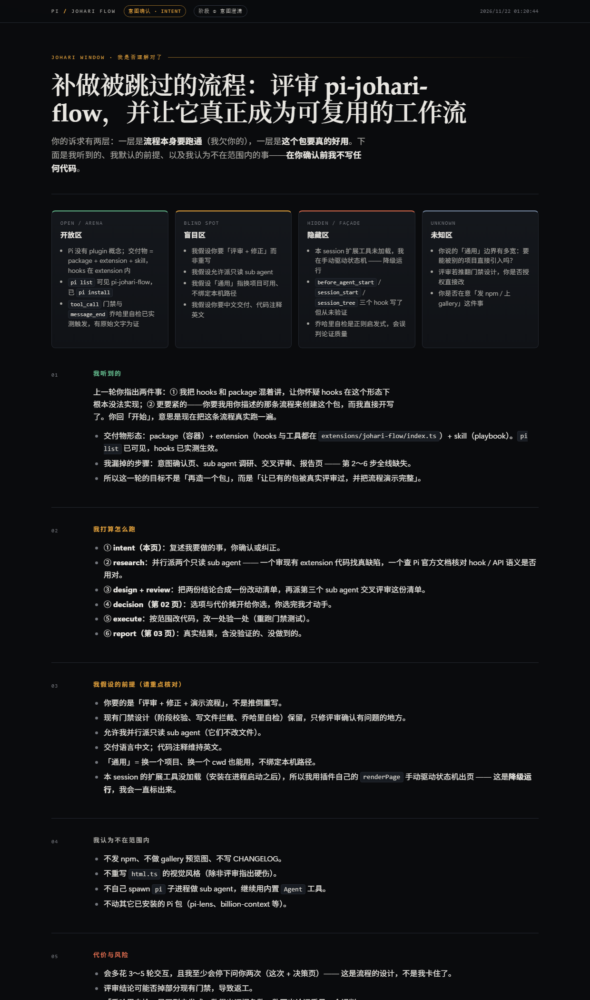
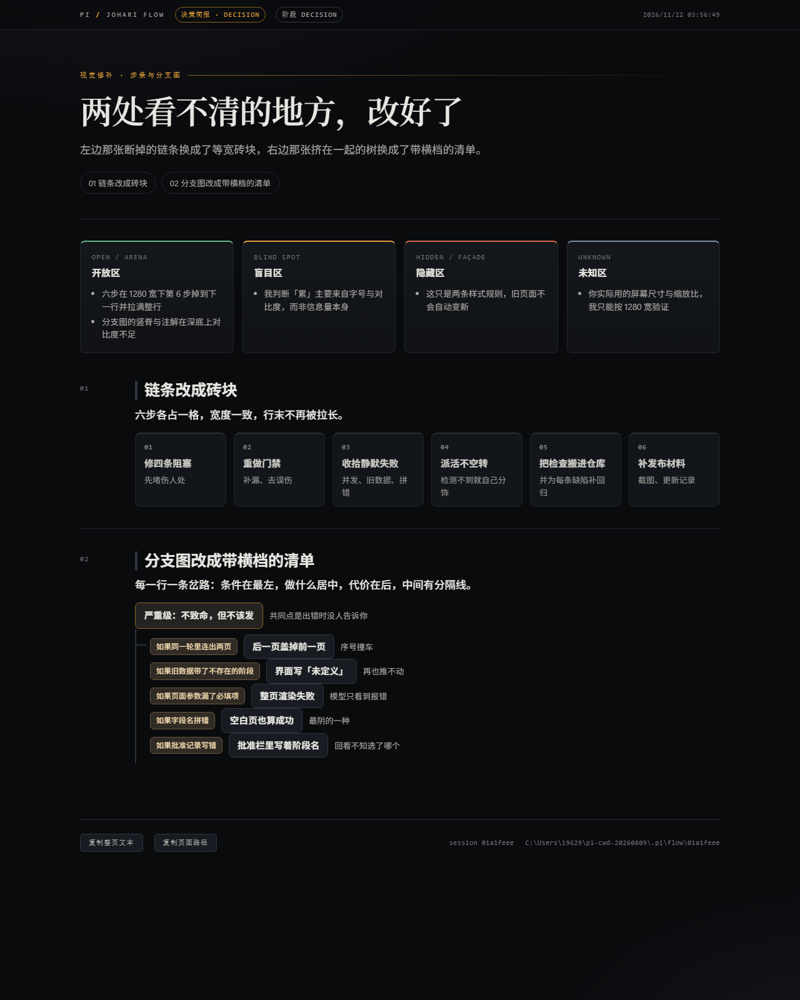

# pi-johari-flow

A delivery workflow for [Pi](https://github.com/earendil-works/pi-coding-agent) that makes the
agent **prove it understood you before it writes anything** — intent page, fact research,
option design, cross review, supervised execution, HTML report. Enforced by hooks, not by good manners.

```bash
pi install git:github.com/iranolly/pi-johari-flow@v0.1.3
```

Already installed? `pi update --extensions` pulls the newest tag, then `/reload` inside a session
(or restart Pi) to pick it up.

Requires Pi ≥ 1.2 (Node ≥ 22.6). Nothing else — no build step, no server, no network calls.

---

## The problem it solves

A coding agent rarely fails because it cannot type. It fails because:

- it understood something else and started anyway — **blind spot**;
- it knew a risk and stayed quiet — **hidden area**;
- it guessed at something it could have looked up — **unknown area**.

A Johari window is a way to close those three gaps. This package turns that idea into a state
machine: nothing gets written while the intent is unconfirmed, nothing gets executed before you
pick a design, and every phase has to leave evidence behind.

## Quick start

```text
/flow start 把登录页改成手机号 + 验证码登录
```

The agent writes an intent page (`.pi/flow/<session>/01-intent.html`) and hands you its `file://`
address in the chat instead of stealing focus with a browser window. It waits for your answer,
then researches, designs, cross-reviews, and only after you approve does it touch code.
The full browser-driven version: run `/flow start <goal>` and follow the pages.

## How it works

| Phase | What the agent does | What is blocked |
| --- | --- | --- |
| ① intent | mines your goal, writes a confirmation page | project code writes and shell writes; sub-agent dispatch (pages and notes under `.pi/` stay writable) |
| ② research | read-only fact gathering, each claim carries evidence | project code writes, shell mutations, destructive commands |
| ③ design | ≥2 options with cost and rollback | same as above |
| ④ review | cross review from different angles | same as above |
| ⑤ approved | recorded approval with your words | nothing (gate lifted) |
| ⑥ execute | dispatch → verify → ask → dispatch loop | nothing, but scope changes must be asked |
| ⑦ report | HTML report page, no code, no jargon | finishing without a report |
| done | closed | nothing; `advance to="idle"` starts fresh |

Phase transitions live in `extensions/johari-flow/types.ts`; anything not in that graph is
refused by `flow_plan`. Three transitions have extra conditions: `research` needs the intent
confirmed, `execute` needs a recorded approval, and `done` needs a report page. A report page
can only be produced in `execute` or `report`.

## Three tools, one command

| Surface | Purpose |
| --- | --- |
| `flow_plan` | `start` / `setGoal` / `status` / `advance` / `confirm` / `approve` / `abort` |
| `flow_page` | intent, decision and report pages (HTML, offline) |
| `flow_ask` | one decision: an in-chat picker whose choices carry their cost, so it works without a page — `open:true` switches to the page-first mode; returns `answered:false` in `-p` / JSON mode |
| `/flow` | `status` · `start <goal>` · `approve` · `report` · `abort` |

`setGoal` re-opens the intent phase (goal changes void the old confirmation). It is refused
after approval — go back to `design` first. `flow_ask` needs at least two options. `flow_page` does
**not** open a browser by default: it returns a `file://` address you can hand to the user, and only
`open:true` launches one.

## The pages

Pages are plain HTML written to `.pi/flow/<session>/`; the chat gets a `file://` address and the
browser stays closed unless you ask. Next to every page sits a `NN-<kind>.json` record holding the
exact spec, phase, cwd, version and timestamp it was rendered from — the HTML is the output, the
JSON is the input you can audit or re-render. Pages carry a
four-quadrant panel (open / blind / hidden / unknown) so you can see what is *assumed*. Decision
pages are a list of **independent single-choice questions** — never one bundled pick — and each
choice copies a paste-ready receipt back into the chat.



Thirteen carriers, picked by the shape of the content. Each `blocks[]` entry needs `kind` plus
the field named below:

| `kind` | field | use it for |
| --- | --- | --- |
| `flow` | `steps` | a linear chain of steps, 2–6 |
| `timeline` | `events` | things that happened in order |
| `stats` | `stats` | a few big numbers |
| `bars` | `bars` (+ `caption`) | comparing magnitudes |
| `compare` | `left` / `right` | before vs after, option vs option |
| `callout` | `text` (+ `tone`) | one thing the reader must not miss |
| `loop` | `steps` | a cycle that returns to step 1 |
| `facts` | `facts` | label → value pairs |
| `tree` | `items` (flat `id` + `parent`) | hierarchy, code map |
| `branch` | `items` (flat `id` + `parent` + `cond`) | if-this-then-that paths |
| `sequence` | `actors` + `messages` | who says what to whom, in order |
| `graph` | `nodes` + `edges` | what depends on what |
| `state` | `states` + `transitions` | states and jumps between them |
| `image` | `images` (`src` + `caption`) | screenshots the reader must actually see |

An unknown or misspelled `kind` renders a visible warning card instead of a silent blank spot.
Local paths in the copy (`comet-audit/timeline.html`, `notes/a.png`) turn into clickable links
when the file exists, and bare `https://` URLs are clickable too — no link syntax needed.
A link to a picture becomes the picture; `json` / `log` / `csv` records never become links.
Report pages are written for people who never read code: no code blocks, no file names.



## Requirements and graceful degradation

- **Sub-agent dispatch is optional.** If your build exposes a dispatch tool (`Agent`,
  `subagent`, `task`, …) the protocol names it and asks for one agent per angle. If it does not,
  the protocol switches to *degraded self-review*: you review from several angles yourself and
  label the result as degraded on every page.
- **Asking does not hijack the browser.** By default `flow_ask` asks in the chat: the picker is the
  dialog the host already shows for pending questions (Pi Web rings and dots it), and every choice
  carries its cost. A page is still written as an artifact, but nothing opens it.
- **Answering on the page is opt-in.** With `open:true` the tool starts a loopback-only listener for
  exactly one question, bakes its address and a random token into the page, and opens it. Clicking
  an option posts the id back and the tool returns it — no copy, no paste. The listener dies with
  the question; a page that outlives it is a read-only archive and says so.
- **UI is optional.** In `-p` / JSON mode `flow_ask` reports that it could not ask instead of
  pretending, and `flow_page` writes the page without launching a browser.

## Comparison

| | pi-johari-flow | Plan mode | Spec-driven kits |
| --- | --- | --- | --- |
| Gate before writing code | hard gate in hooks | advisory | advisory |
| What you confirm | an HTML page you can audit | a prose plan | a markdown spec |
| Evidence trail | per-phase history + page files | none | spec files |
| Cognitive debt surfaced | four quadrants on every page | implicit | implicit |
| Cost | approval tax on multi-file work | low | medium |

The failure mode of workflow tools is not missing features but *output inflation* and *approval
fatigue*. This package tries to pay for its friction: pages replace prose, and questions are
batched into independent single choices instead of a chain of confirmations.

## Security and limits

- Pages are fully offline: no CDN, no fonts, no telemetry, no network access. Page-level CSS is
  sanitised, so a stray model-written stylesheet cannot inject markup.
- Gates are heuristics over tool names and shell text. Read-only commands keep their right to
  quote dangerous strings; genuinely novel ways to write a file can still slip through. Treat the
  gates as a strong seat belt, not as a sandbox. Writes that stay inside `<cwd>/.pi/` (pages,
  scratch notes) are always allowed, so the flow itself never blocks on its own output.
- `abort` always works: `flow_plan {action:"abort"}` (or `/flow abort`) lifts every gate
  immediately.
- Nothing is sent anywhere. The only files created are under `.pi/flow/` in your workspace
  (add `.pi/` to your `.gitignore` if you do not want them committed).

## Uninstall and cleanup

```bash
pi remove git:github.com/iranolly/pi-johari-flow   # package name alone will not match
rm -rf .pi/flow                                   # delete generated pages
```

Add `.pi/` to your `.gitignore` if you do not want the generated pages in version control.

## Development

```bash
npm test        # 80 checks, no dependencies: node --experimental-strip-types tests/run.mjs
```

The suite links the three host packages Pi already ships and drives the extension through the
same hooks Pi uses (gates, phase machine, page writing, CSS sanitiser, `flow_ask`,
`setGoal`, `abort`). See `CHANGELOG.md` for what changed in 0.1.4.

## License

MIT © iranolly
